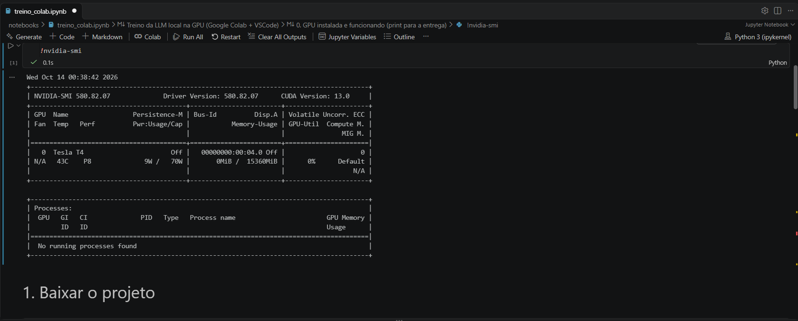

# LLM local para diagnóstico de logs de integração (Sienge ↔ Hilti)

Fine-tuning de uma LLM pequena (**Qwen2.5-0.5B-Instruct**) com **LoRA**, treinada em **GPU NVIDIA (CUDA)**,
para ler uma linha de log de erro de uma integração real entre ERP e sistema de ferramentas e responder
um **diagnóstico estruturado em JSON**: categoria do erro, sistema afetado, severidade, código HTTP,
se o erro é transitório e qual ação tomar.

**Integrantes**

| Nome | RM |
|---|---|
| Victor Eid Carbutti Nicolas | RM98668 |
| Tiago Rafael Paulino Ferreira | RM551169 |

---

## 1. O problema

Uma empresa de instalações prediais mantém uma integração em Python que sincroniza o estoque entre o
ERP **Sienge** e o **Hilti ON!Track** em cerca de 70 obras. A integração tem três serviços:

- **Porteiro** recebe webhooks do Sienge e atualiza a Hilti.
- **Motor** lê as transferências da Hilti e lança saídas no Sienge.
- **Auditor** roda toda noite e corrige as divergências de estoque.

Entre junho e outubro de 2026 esses serviços geraram mais de **50 mil linhas de WARNING/ERROR**:
timeouts, erros HTTP 4xx/5xx, regras de negócio do Sienge (apropriação inválida, falta de custo médio),
falta de saldo e outros. Ler esses logs exige conhecer a integração. A ideia é que a LLM faça a triagem:

**Entrada (prompt)**
```
[ERROR] Motor - Sienge recusou CM: CC=1049 lote=1 (HTTP 422): {"status":422,"developerMessage":"Não há custo médio disponível para a data do movimento."}
```
**Saída esperada**
```json
{"origem": "motor", "categoria": "sem_custo_medio", "sistema_afetado": "sienge", "severidade": "alta",
 "http_status": 422, "transitorio": false,
 "acao_sugerida": "Lancar inicializacao ou entrada com custo antes da data do movimento."}
```

Por que esse problema é bom para uma LLM pequena:
- É **real**: os dados são o histórico de produção da integração.
- É **mensurável**: existe uma resposta certa para cada linha, então dá para calcular a % de acerto.
- O texto é **ruidoso**: há IDs variados, mensagens em JSON aninhado, stack traces e português misturado
  com inglês. Uma regex só funciona para padrões conhecidos, enquanto o modelo aprende a generalizar.

## 2. Escolha do modelo

| Critério | Qwen2.5-0.5B-Instruct |
|---|---|
| Tamanho | 0,5 bilhão de parâmetros (cerca de 1 GB em bf16) |
| Cabe em | GPU T4 de 16 GB com folga. Também roda na CPU para inferência. |
| Idioma | Multilíngue, entende português |
| Licença | Apache 2.0 |
| Por quê | Pequeno o bastante para treinar em minutos e servir localmente, e já é um modelo *instruct*, que segue formato de chat |

**Técnica: LoRA (Low-Rank Adaptation).** O modelo base fica congelado e só pequenas matrizes
adicionadas às camadas de atenção e MLP são treinadas: cerca de **1,75% dos parâmetros** com rank 16 (8,8 milhões de 503 milhões).
O resultado é um *adaptador* de poucos MB.

## 3. Dataset

O script é [`src/preparar_dados.py`](src/preparar_dados.py) e as regras ficam em [`src/rotulos.py`](src/rotulos.py).

1. Lê todos os `motor.log*`, `porteiro.log*` e `auditor.log*` e fica só com WARNING e ERROR.
2. **Anonimiza** os dados: troca URLs por `<URL_SIENGE>`/`<URL_HILTI>`, remove o nome do tenant e
   da empresa e tira os caminhos de usuário.
3. **Rotula automaticamente** com cerca de 25 regras regex. As regras definem a categoria (23 no total)
   e, a partir dela, a severidade, o sistema afetado, se é transitório e a ação.
4. Remove duplicatas: são 6.637 linhas únicas. Limita os exemplos por categoria para equilibrar as classes,
   porque só "obra fora do mapa" tem mais de 31 mil ocorrências.
5. **Divisão temporal:** o teste usa logs a partir de 15/09/2026 que não apareceram antes. Assim, o
   teste mede se o modelo generaliza para logs novos.

| Conjunto | Exemplos |
|---|---|
| Treino | 499 |
| Validação | 53 |
| Teste | 118 |

A distribuição por categoria está em [`data/resumo_dataset.json`](data/resumo_dataset.json).

## 4. Treino e experimentos

Os scripts são [`src/treinar.py`](src/treinar.py) (loop de treino em PyTorch + PEFT) e
[`src/experimentos.py`](src/experimentos.py). A loss é calculada **apenas sobre a resposta JSON**: os
tokens do prompt recebem label `-100`. Otimizador AdamW, schedule cosseno com warmup, batch 4 e bf16 na GPU.

| Experimento | lr | rank LoRA | épocas | O que testa |
|---|---|---|---|---|
| exp1 | 2e-4 | 16 | 2 | Configuração de referência |
| exp2 | 5e-5 | 16 | 2 | Learning rate menor |
| exp3 | 2e-4 | 4 | 2 | Adaptador menor (menos parâmetros) |
| exp4 | 2e-4 | 16 | 1 | Menos épocas |
| exp5 | 1e-3 | 16 | 2 | Learning rate alto |

## 5. Avaliação

O script é [`src/avaliar.py`](src/avaliar.py). Ele gera as respostas com decodificação gulosa
(temperatura 0) e compara com o gabarito.

- **json_valido:** % de respostas que são JSON legível.
- **acerto por campo:** % de acerto em categoria, severidade, sistema, http_status, transitório e ação.
- **acerto_total:** % de respostas com todos os campos corretos.
- **f1_macro_categoria:** F1 médio por categoria, que penaliza errar as classes raras.

### Resultados

<!-- RESULTADOS -->
*(preenchido após o treino na GPU — ver `resultados/comparacao.md`)*


## 6. GPU

Todo o treino e a avaliação rodaram em **GPU NVIDIA Tesla T4 (16 GB, CUDA)** no Google Colab,
**conectado ao VSCode** pela extensão oficial *Google Colab*, conforme autorizado pelo professor.



O script [`src/verificar_gpu.py`](src/verificar_gpu.py) mostra a versão de PyTorch/CUDA, o nome e a
memória da GPU e compara a velocidade de multiplicação de matrizes na GPU e na CPU.

## 7. Frontend

O frontend fica em [`app/app.py`](app/app.py) e usa **Gradio**. O usuário cola ou digita uma linha de log,
escolhe o modelo (base ou um dos adaptadores treinados) e ajusta a temperatura e o máximo de tokens.
A tela mostra o diagnóstico em JSON e a resposta bruta.


## 8. Como rodar

### Na GPU (Colab dentro do VSCode)
1. No VSCode, instale as extensões **Jupyter** e **Google Colab**.
2. Abra [`notebooks/treino_colab.ipynb`](notebooks/treino_colab.ipynb), clique em *Select Kernel → Colab →
   New Colab Server → GPU T4* e faça login com uma conta Google.
3. Rode as células em ordem. A célula `!nvidia-smi` mostra a GPU, e o fim do notebook baixa o
   `resultados_colab.zip`.

### Localmente
```bash
python -m venv .venv
.venv\Scripts\activate          # Windows
pip install torch --index-url https://download.pytorch.org/whl/cu124   # GPU NVIDIA
# ou: pip install torch --index-url https://download.pytorch.org/whl/cpu
pip install -r requirements.txt

python src/verificar_gpu.py
python src/avaliar.py --nome base
python src/experimentos.py
python app/app.py               # http://127.0.0.1:7860
```

> **CUDA:** a versão do CUDA no PyTorch precisa ser compatível com o driver da placa. Rode `nvidia-smi`
> e veja "CUDA Version" no canto superior direito: é a versão máxima suportada pelo driver. Escolha uma
> roda do PyTorch igual ou menor (cu118, cu121, cu124...).

## 9. Estrutura

```
├── app/app.py                 frontend Gradio
├── data/                      dataset anonimizado (treino/validacao/teste)
├── notebooks/treino_colab.ipynb
├── resultados/                métricas, predições, tabela e gráficos
├── runs/<experimento>/        adaptador LoRA + histórico de loss
└── src/
    ├── verificar_gpu.py       etapa 0 - GPU
    ├── preparar_dados.py      etapa 1 - dataset
    ├── rotulos.py             regras de rotulagem
    ├── treinar.py             etapa 2 - fine-tuning LoRA
    ├── avaliar.py             etapa 3 - métricas
    ├── experimentos.py        etapa 4 - grade de parâmetros
    └── comum.py               prompt, dispositivo, carregamento
```
